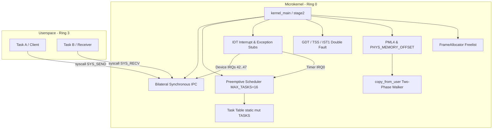
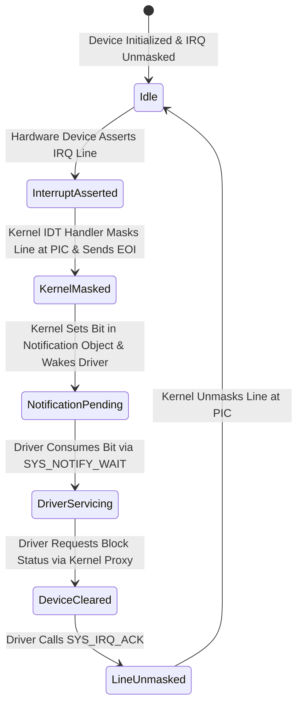
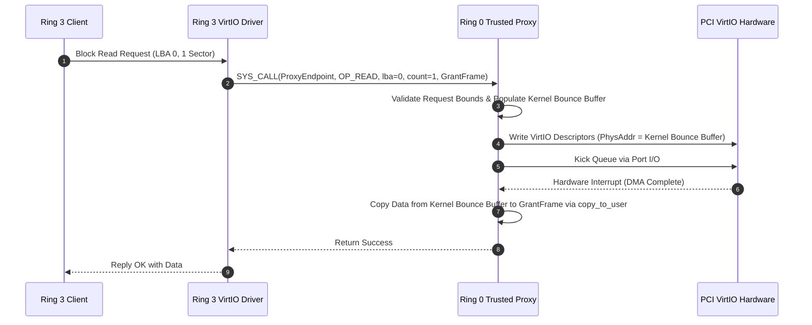

# Janus OS — Milestone 3 Technical Design (Stage 3.0 Final Amendment)
## Driver Isolation & Capability Delegation Framework

**Document Version:** 2.1.0 (Stage 3.0 Final Architectural Clarification)  
**Target Architecture:** x86_64 (Microkernel)  
**Status:** AMENDED SPECIFICATION — READY FOR STAGE 3.0 IMPLEMENTATION  
**Branch:** `main`  
**Base Commit:** `d288cadd17aee34ddac16f95de89ddb16b329f92` (Integrated M1–M2B)  
**Security Audit References:** `docs/architecture/MILESTONE_3_REVIEW.md`, `docs/architecture/MILESTONE_3_SECOND_REVIEW.md`  

---

## 1. Executive Summary & Architectural Vision

Milestones M1, M2A, and M2B established the fundamental security and control-flow foundation of Janus OS:
- **M1:** Hardened architectural GDT/TSS handling, interior mutability of `TaskStateSegment` without undefined behavior, dedicated 16-byte aligned double-fault IST1 stack switching, and corrected idle task initial stack headroom.
- **M2A:** Strict two-phase software page-table walk validation for userspace memory (`copy_user_u32` for `SYS_LOG`), canonical address checking, user/supervisor bit enforcement, huge-page reserved bit checks, and physical direct-map bounds checks.
- **M2B:** Bilateral endpoint capability authorization, dead-target blocking prevention, self-IPC deadlock elimination, and sound scoped lifetimes for task table accessors.

With these core kernel mechanisms verified in CI, Janus must transition from hardcoded static kernel proofs to a true microkernel architecture where **device drivers run as unprivileged user-space services in Ring 3**, isolated behind strictly enforced capability boundaries.

### Core Objectives of Milestone 3:
1. **Dynamic Virtual Memory Foundation (Stage 3.0 Prerequisite):** Provide robust, dynamic per-task 4-level page table management, kernel higher-half mapping inheritance, user-space virtual memory allocation/deallocation, explicit frame ownership separation, and strict W^X enforcement.
2. **Dynamic Object-Capability Delegation (Stage 3.1):** Transition from static task capability slots to an expressive object-capability model supporting fine-grained rights bitmasks, rights attenuation, badged endpoints, safe derivation trees via a deterministic Capability Derivation Table (CDT), and deterministic cascading revocation within a strict 32-byte slot layout.
3. **Hardware-Aware Asynchronous Notifications (Stage 3.2):** Deliver non-blocking hardware interrupt events to driver tasks using atomic 64-bit notification bitmasks, pairing PIC/IOAPIC hardware line masking on dispatch with explicit user-space driver acknowledgment (`SYS_IRQ_ACK`) to prevent level-triggered interrupt storms.
4. **Capability-Authorized Syscalls (Stage 3.3):** Expose a minimal, hardened system call interface for capability derivation, frame mapping, asynchronous notification signaling/waiting, and IRQ acknowledgment, ensuring zero raw user pointers are dereferenced in Ring 0.
5. **Ring 3 Driver Isolation & Safe Kernel DMA Proxying (Stage 3.4):** Execute the VirtIO block driver in Ring 3 with zero ambient kernel privileges and **no direct I/O port or MMIO access to VirtIO device registers**. For Milestone 3 (non-IOMMU hardware), restrict physical bus-mastering DMA through a trusted in-kernel bounce-buffer proxy to prevent untrusted Ring 3 code from overwriting arbitrary physical DRAM.
6. **Fault Containment & Transparent Recovery (Stage 3.5):** Trap driver crashes, page faults, and general protection faults in Ring 3 without crashing the microkernel. Quiesce hardware devices synchronously before any memory frames or capabilities are reclaimed, preventing in-flight DMA corruption upon service re-spawn.

---

## 2. Existing Baseline Architecture (v1.0 / Post-M2B)

An audit of the repository at commit `d288cad` establishes the baseline state of Janus OS:



### Verified Subsystem State & Deficiencies:
1. **Paging & Memory Management (`kernel/src/paging.rs`, `kernel/src/memory.rs`):**
   - Implements bootloader root page table initialization (`init_root_page_table`) and establishes `PHYS_MEMORY_OFFSET = 0xFFFF_9000_0000_0000`.
   - Validates user addresses via `copy_from_user_with_reader` using a two-phase software page-table walk.
   - The concrete allocator is `FrameAllocator` in `memory.rs`. It is a freelist allocator where `allocate_frame()` returns **unzeroed** memory containing stale freelist pointers in the first 8 bytes.
   - **Deficiency:** Completely lacks dynamic virtual memory mapping primitives. There are no functions to map (`map_user_page`), unmap (`unmap_user_page`), dynamically allocate intermediate page tables (`PDPT`, `PD`, `PT`), or construct independent per-task PML4 root tables.
2. **Tasks & Scheduling (`kernel/src/task.rs`, `kernel/src/main.rs`):**
   - Fixed table of 16 tasks (`MAX_TASKS = 16`). Round-robin cooperative/preemptive scheduler driven by timer interrupts. Context switching in `task.rs` already reloads `CR3` on switch.
   - **Deficiency:** In `main.rs`, all tasks share a single global `user_pml4_paddr`. True per-task address space separation does not exist.
3. **Capabilities & CNode (`kernel/src/capability.rs`):**
   - Fixed 128-slot CNode (`CNODE_SLOTS = 128`) asserted to fit in 4096 bytes: `assert!(size_of::<CNode>() <= 4096)`.
   - Slots store only `Capability` (24 bytes). No rights bitmasks, badges, derivation tracking, or generation counters exist.
4. **Interrupt & Device Handling (`kernel/src/pic.rs`, `kernel/src/idt.rs`, `kernel/src/pci.rs`):**
   - 8259 PIC remapped to vectors 32..47.
   - `idt.rs` dispatches device IRQs (42..47) by immediately acknowledging the PIC (`pic::end_of_interrupt`) and calling `ipc::wake_irq`.
   - **Deficiency:** Does not mask the PIC line on interrupt entry. For level-triggered PCI interrupts, this causes an immediate infinite interrupt storm if the device register is not cleared synchronously.
   - `pci.rs` scans PCI config space and sets Bus Master Enable directly in Ring 0 during boot.

---

## 3. Mandatory Architectural Decisions (ADR Summary)

### Decision A: DMA Threat Boundary & Trusted Kernel DMA Proxy (ADR-05)
- **Scope & Boundary:** Milestone 3 provides CPU privilege separation, Ring 3 unprivileged execution, capability-mediated resource access, and driver fault isolation. It **does NOT claim hardware-enforced DMA isolation**.
- **Hardware Reality:** On x86 platforms without an IOMMU (Intel VT-d / AMD-Vi), PCI bus-mastering hardware devices bypass the CPU MMU/CR3 entirely. An untrusted Ring 3 process with direct access to device registers can program arbitrary physical addresses into descriptor queues. Restricting physical addresses returned by `SYS_MAP_FRAME` is **insufficient** to prevent malicious DMA.
- **Architectural Policy (Absolute Authority Boundary):**
  1. Full hardware-enforced DMA containment via IOMMU is deferred to **Milestone 4**.
  2. For Milestone 3, untrusted Ring 3 drivers must **NOT receive direct bus-mastering authority or hardware register access**.
  3. The Ring 3 driver receives **NO `IOPort` or `MmioFrame` capability to VirtIO device registers** (BAR `0xC000..0xC040` or PCI config `0xCF8/0xCFC`).
  4. Stage 3.4 will implement a **Trusted Kernel Bounce-Buffer DMA Proxy**: The Ring 3 driver manages the logical block request protocol via IPC, while the trusted kernel proxy validates buffer bounds, populates physical DMA descriptors using dedicated kernel bounce buffers, and programs the hardware registers.
  5. Memory reclamation following driver faults is strictly gated on proven hardware quiescence.

### Decision B: Driver Binary Packaging — Validated Embedded ELF (ADR-06)
- **Scope:** Milestone 3 will package driver binaries as embedded ELF64 executables linked into `.rodata` of the kernel image (or loaded as raw boot modules).
- **Validation Pipeline:** Embedded binaries are **not trusted by default**. The kernel ELF loader must rigorously enforce:
  1. `e_ident` validation: ELF magic (`0x7F 'E' 'L' 'F'`), 64-bit class (`ELFCLASS64`), little-endian (`ELFDATA2LSB`), current version (`EV_CURRENT`), SysV ABI.
  2. Target architecture: `e_machine == EM_X86_64` (0x3E).
  3. Type: `e_type == ET_EXEC` (statically linked, no dynamic relocations).
  4. Bounds validation: Header offsets (`e_phoff`, `e_shoff`) and segment sizes must reside strictly within the embedded blob boundary.
  5. Segment permissions & W^X: Segments are mapped into user space with strict W^X enforcement. Text is `PRESENT | USER_ACCESSIBLE` (and `NO_EXECUTE` bit cleared). Data/BSS is `PRESENT | USER_ACCESSIBLE | WRITABLE | NO_EXECUTE`. No segment may be both writable and executable.
  6. Entry point validation: `e_entry` must reside within an executable `PT_LOAD` segment.
  7. Extensibility: The ELF loader interface accepts a generic byte slice `&[u8]`, preserving a seamless transition to standalone ramdisk/UEFI boot modules in Milestone 4.

### Decision C: CNode Slot Representation, Derivation Model, & Size Bounds (ADR-07)
- **Constraint:** Single-page 4 KiB CNode with 128 slots is provisionally retained:
  $$\text{Slot Size Budget} = \frac{4096 \text{ bytes}}{128} = 32 \text{ bytes}$$
- **Architectural Layout & Exact Offset Map:**
  To guarantee exact 32-byte layout under Rust `#[repr(C)]` alignment rules, natural padding must be explicitly accounted for:
  ```rust
  #[repr(C)]
  #[derive(Debug, Clone, Copy)]
  pub struct CNodeSlot {
      pub cap_type: CapType,         // offset  0, size 1
      pub rights: CapRights,         // offset  1, size 1
      pub generation: u16,           // offset  2, size 2
      // 4 bytes natural alignment padding inserted here by compiler (offset 4..8)
      pub payload_a: u64,            // offset  8, size 8 (alignment 8)
      pub payload_b: u64,            // offset 16, size 8 (alignment 8)
      pub cdt_index: u32,            // offset 24, size 4
      pub _reserved: [u8; 4],        // offset 28, size 4 (padding to 32 bytes)
  }

  const _: () = assert!(core::mem::size_of::<CNodeSlot>() == 32);
  const _: () = assert!(core::mem::align_of::<CNodeSlot>() == 8);

  #[repr(C, align(4096))]
  pub struct CNode {
      pub slots: [CNodeSlot; 128],
  }

  const _: () = assert!(core::mem::size_of::<CNode>() == 4096);
  ```
- **Deterministic CDT Indexing:**
  With `MAX_TASKS = 16` and `CNODE_SLOTS = 128`, the total system capability capacity is fixed at $16 \times 128 = 2,048$ slots. The Capability Derivation Table (CDT) is statically allocated and deterministically indexed by:
  $$\text{cdt\_index} = (\text{task\_id} \times 128) + \text{slot\_index}$$
  This completely eliminates CDT allocation failure, heap fragmentation, and table exhaustion.

### Decision D: Phased Mapping Syscall Sequencing (ADR-08)
- **Sequencing:** Stage 3.0 develops kernel-internal dynamic virtual memory management primitives first.
- **Syscall Gate:** User-facing mapping system calls (`SYS_MAP_FRAME`, `SYS_UNMAP_FRAME`) must **not be exposed** until Stage 3.3, after the Stage 3.1 capability authorization engine has been fully implemented, tested, and reviewed.
- **No Ambient Physical Mapping:** At no point may user space map arbitrary physical memory. All mappings require proof of ownership via an authorized `Frame` or `MmioFrame` capability handle.

---

## 4. Deep Subsystem Architecture & Execution Model

---

### 4.1 Stage 3.0 — Dynamic Virtual Memory Management Subsystem (Prerequisite)

Stage 3.0 establishes the missing virtual memory foundation in `kernel/src/paging.rs`.

#### 4.1.1 Physical Frame Ownership & Classification Contract
To prevent memory corruption, double-frees, and use-after-free conditions, Stage 3.0 establishes an explicit, rigorous classification of physical frames:

1. **Page-Table Frames (Kernel-Owned):**
   - **Allocation:** Dynamically allocated by `map_user_page` and `create_user_pml4` using `PhysFrameAllocator`.
   - **Initialization Invariant:** Every page-table frame (PML4, PDPT, PD, PT) **MUST be explicitly zeroed across all 4,096 bytes via the direct-map (`PHYS_MEMORY_OFFSET + paddr`) before being read, populated, or linked**.
   - **Protection:** Page-table frames are strictly kernel-internal. They are never exposed to user tasks as normal data frames.
   - **Reclamation:** Page-table frames are freed back to `PhysFrameAllocator` exclusively when the owning address space is destroyed via `destroy_user_pml4`, or when intermediate tables become empty.
   - **Kernel Higher-Half Invariant:** Shared kernel page-table entries (`PML4[256..511]`) must **NEVER be traversed, modified, or freed** during user address space teardown.

2. **Leaf Frames (Caller-Owned):**
   - **Supply:** Leaf physical frames (`paddr`) are supplied by the caller (kernel task manager or capability subsystem) to `map_user_page`.
   - **No Implicit Ownership Transfer:** The paging subsystem is a pure translation mapping engine. It does **not** acquire lifecycle ownership of leaf frames.
   - **Unmapping Contract:** `unmap_user_page` removes the mapping from the leaf PT entry, flushes the TLB, and returns the physical address `paddr`. It **does NOT free the leaf frame back to the allocator**.
   - **Teardown Contract:** `destroy_user_pml4` traverses and frees intermediate page-table structures (PTs, PDs, PDPTs, and the user PML4), but **does NOT free mapped leaf frames**. Caller/process management retains exclusive responsibility for leaf-frame lifetime.

3. **Shared Frames & Caller-Enforced Lifetime:**
   - A single physical leaf frame may be mapped into multiple independent task address spaces (e.g. shared IPC grant buffers or read-only shared libraries).
   - Unmapping a shared frame in task A must not invalidate or alter the mapping in task B.
   - Because Janus's `FrameAllocator` is a simple freelist without atomic reference counts, **Stage 3.0 relies on a caller-enforced lifetime invariant**: the caller/task manager must track active mappings and guarantee a physical leaf frame is freed to `PhysFrameAllocator` only after it has been unmapped from all address spaces.

4. **Failure Rollback & Partial Teardown Semantics:**
   - `map_user_page` must track all intermediate table frames allocated during its execution.
   - If allocation fails midway (e.g. PDPT succeeds, PD succeeds, PT fails), all intermediate tables allocated during that specific transaction must be rolled back, freed back to `allocator`, and unlinked from parent tables before returning `Err(PagingError::OutOfMemory)`.
   - Pre-existing page-table structures must never be disturbed during failure rollback.
   - `destroy_user_pml4` must be safe against partially constructed page-table trees.

#### 4.1.2 Physical Aliasing & W^X Policy
- **Virtual vs. Physical W^X:**
  - Checking `flags` inside `map_user_page` guarantees that a single virtual page cannot be both writable and executable (`PagingError::WxViolation`).
  - However, virtual checking alone does **not** prevent physical aliasing (mapping physical frame $P$ as writable at $V_1$ and executable at $V_2$).
  - Full hardware physical-aliasing prevention requires a centralized physical frame mapping registry, which is formally deferred to **Stage 3.1 (Capability Engine)** where frame capabilities govern rights.
  - **Stage 3.0 Security Boundary:** Stage 3.0 guarantees virtual W^X per-mapping and enforces caller responsibility against creating conflicting physical aliases.
- **User/Supervisor Boundary Invariants:**
  - User leaf entries are marked `PageTableFlags::USER_ACCESSIBLE`.
  - Intermediate entries (PML4, PDPT, PD in entries 0..255) must also be marked `PageTableFlags::USER_ACCESSIBLE` to satisfy the architectural x86_64 requirement that all levels allow user access for leaf pages to be reachable in Ring 3.
  - Intermediate entries do not weaken security because protection is enforced strictly at the leaf PT entry.
  - Higher-half kernel entries (256..511) have `USER_ACCESSIBLE` cleared (`U/S = 0`), preventing Ring 3 access regardless of user-space configurations.
- **TLB Invalidation Contract (Uniprocessor):**
  - If `pml4_paddr == active_cr3`: issue `invlpg [vaddr]` immediately upon unmap or permission downgrade.
  - If `pml4_paddr != active_cr3`: no immediate `invlpg` is executed; TLB invalidation is deferred to the CR3 reload in `task::schedule()` when that task is next scheduled.

---

### 4.2 Stage 3.1 — Capability Delegation Engine & Attenuation

#### 4.2.1 Capability Object Types & Authority
```rust
#[derive(Debug, Clone, Copy, PartialEq, Eq)]
#[repr(u8)]
pub enum CapType {
    Empty = 0,
    Untyped = 1,
    Endpoint = 2,
    Notification = 3,
    CNode = 4,
    Frame = 5,
    MmioFrame = 6,
    IOPort = 7,
    Irq = 8,
}
```
- **`Untyped { paddr: u64, size: u64 }`:** Authority over raw physical memory.
- **`Endpoint { channel_id: u32, badge: u64 }`:** Authority for synchronous rendezvous IPC. Badge is injected by kernel into receiver context.
- **`Notification { object_id: u32 }`:** Authority to signal or wait on an atomic 64-bit event bitmask.
- **`CNode { paddr: u64, slot_count: u16 }`:** Authority to mutate capability slots in a CSpace.
- **`Frame { paddr: u64 }`:** Authority to map a 4 KiB physical RAM frame with cacheable (Write-Back) semantics.
- **`MmioFrame { paddr: u64 }`:** Authority to map a 4 KiB physical hardware register frame with uncacheable (`PCD=1, PWT=1`) semantics.
- **`IOPort { base: u16, count: u16 }`:** Authority to execute `SYS_IN_PORT` / `SYS_OUT_PORT` on permitted non-VirtIO port ranges.
- **`Irq { irq: u8 }`:** Authority to bind a notification to a hardware interrupt line and issue `SYS_IRQ_ACK`.

#### 4.2.2 Rights Bitmask & Attenuation Rules
```rust
bitflags::bitflags! {
    #[derive(Debug, Clone, Copy, PartialEq, Eq)]
    pub struct CapRights: u8 {
        const READ    = 1 << 0;
        const WRITE   = 1 << 1;
        const EXECUTE = 1 << 2;
        const GRANT   = 1 << 3;
        const MAP     = 1 << 4;
        const CALL    = 1 << 5;
    }
}
```
- **Attenuation Invariant:** $\text{Rights}(B) \subseteq \text{Rights}(A)$.
- **Badge Semantics:** Immutable 64-bit caller identification metadata; does not convey authorization.

#### 4.2.3 Generation Counters & CDT Management
- **Generation Wraparound:** Generation is a 16-bit integer incremented on every slot reuse. Generation `0` is reserved for empty/unallocated slots. When `generation == 0xFFFF`, incrementing wraps to `1` (skipping `0`).
- **Deterministic CDT Array:** The kernel maintains a static table of 2,048 entries:
  ```rust
  pub struct CdtNode {
      pub parent: Option<u16>,
      pub first_child: Option<u16>,
      pub next_sibling: Option<u16>,
      pub owner: (u8, u8), // (task_id, slot_idx)
  }
  static mut CDT: [CdtNode; 2048] = ...;
  ```
- **Recursive Revocation (`SYS_CAP_REVOKE`):** Traverses `first_child` $\to$ `next_sibling` recursively. For every child capability, if it is a mapped `Frame` or `MmioFrame`, it unmaps the page; it then clears the slot, increments its generation counter, and unlinks the CDT node.

---

### 4.3 Stage 3.2 — Asynchronous Notifications & Hardware-Aware Interrupt Architecture



- **Masking Invariant:** Kernel IDT handler immediately masks the IRQ line at the PIC via `pic::mask(irq)` *before* issuing EOI (`pic::end_of_interrupt(irq)`), preventing level-triggered IRQ storms.
- **Driver Acknowledgment (`SYS_IRQ_ACK`):** Driver services request and calls `SYS_IRQ_ACK(irq_slot)`; kernel validates `Irq` capability with `WRITE` rights and unmasks the line at the PIC.
- **Driver Crash Protection:** If a driver faults while an IRQ line is masked, fault recovery resets the device and unmasks the PIC line to prevent stranded interrupts.

---

### 4.4 Stage 3.3 — Capability-Controlled System Call Layer

| Syscall | Code | Arguments | Authorization & Preconditions | Description |
| :--- | :--- | :--- | :--- | :--- |
| `SYS_CAP_MINT` | `13` | `src_slot`, `dest_slot`, `rights`, `badge` | `src_slot` must have `CapRights::GRANT`. $\text{rights} \subseteq \text{src.rights}$. | Mints derived capability with attenuated rights/badge. |
| `SYS_CAP_REVOKE` | `14` | `slot` | Caller must hold capability with `CapRights::WRITE` or be owner. | Recursively revokes all child capabilities derived from slot. |
| `SYS_MAP_FRAME` | `15` | `frame_slot`, `vaddr`, `map_flags` | `frame_slot` must be `Frame` or `MmioFrame` with `CapRights::MAP`. | Maps physical frame into caller's PML4 with validated flags. |
| `SYS_UNMAP_FRAME` | `16` | `vaddr` | Caller must own mapping at `vaddr`. Cannot unmap kernel pages. | Unmaps virtual page, flushes TLB, leaves leaf frame untouched. |
| `SYS_NOTIFY_WAIT` | `17` | `notify_slot` | Caller must hold `Notification` capability with `CapRights::READ`. | Atomically clears and returns pending notification bitmask. |
| `SYS_NOTIFY_SIGNAL` | `18` | `notify_slot`, `bits` | Caller must hold `Notification` capability with `CapRights::WRITE`. | Atomically sets bits in target notification object. |
| `SYS_IRQ_ACK` | `19` | `irq_slot` | Caller must hold `Irq` capability with `CapRights::WRITE`. | Verifies IRQ ownership and unmasks line at PIC/IOAPIC. |

---

### 4.5 Stage 3.4 — Isolated Ring 3 Driver Architecture (VirtIO Storage)

#### 4.5.1 Strict Kernel DMA Proxy Boundary
To ensure absolute memory safety on non-IOMMU hardware:
1. **Zero Register Delegation:** The Ring 3 driver receives **NO** `IOPort` or `MmioFrame` capability to the VirtIO BAR (`0xC000..0xC040`).
2. **Kernel Ownership:** All device registers, VirtQueue descriptor rings, Available rings, Used rings, and PCI configuration spaces are owned **exclusively by the kernel**.
3. **IPC Block Request Protocol:** The driver interacts with storage via high-level IPC messages:
   ```rust
   // Driver issues validated block request to kernel proxy
   SYS_CALL(kernel_block_endpoint, op=BLOCK_READ, lba=0, count=1, grant_frame_cptr);
   ```
4. **Kernel Bounce Buffering:** The kernel allocates dedicated DMA buffers in kernel memory, populates physical descriptors, kicks the hardware queue, handles the interrupt, and copies the verified data into the driver's granted user frame using `copy_to_user`.
5. **Security Result:** The untrusted driver cannot touch device registers, program queue addresses, or initiate bus-master DMA.



---

### 4.6 Stage 3.5 — Fault Containment & Synchronous Reset Recovery

#### 4.6.1 Conservative Hardware Quiescence Sequence
Before any memory frames or capabilities are reclaimed from a crashed driver:
1. Clear Bit 2 (`Bus Master Enable`) in the PCI Command Register via `pci::write_config`.
2. **PCI Read-After-Write Flush:** Perform `pci::read_config` on the Command Register to flush posted PCI transactions.
3. Write `0` to the VirtIO Device Status register.
4. Read back the Device Status register in a loop until it returns `0` (or watchdog timeout expires).
5. If the device fails to report status `0` within the timeout, the device is deemed wedged. The kernel halts the driver, permanently disables the device, and **never reclaims or reassigns the underlying memory frames**.

---

## 5. Revised Threat Matrix & Hardened Mitigations

| Threat ID | Threat Description | Attack Vector | Architectural Mitigation | Subsystem Responsible |
| :--- | :--- | :--- | :--- | :--- |
| **THREAT-01** | **I/O Port & Register Escape** | Compromised driver attempts to program VirtIO registers or motherboard ports. | Driver runs in Ring 3 with IOPL=0. Direct `in`/`out` triggers #GP. **No `IOPort` capability for VirtIO BAR is granted to the driver.** Device registers are owned exclusively by the kernel. | `kernel::ipc`, `kernel::pci` |
| **THREAT-02** | **DMA Range Corruption** | Compromised driver attempts to program device to DMA into kernel memory. | Driver has no access to device registers or physical queue configuration. All DMA is executed through the Trusted Kernel Bounce-Buffer Proxy using kernel-owned buffers. | `kernel::virtio_proxy` |
| **THREAT-03** | **Capability Forgery** | User task passes raw pointer as `CPtr` to access resources of another task. | `CPtr` is an index into task's private CNode. All mutations require kernel-mediated minting with rights attenuation. | `kernel::capability` |
| **THREAT-04** | **Confused Deputy** | Client tricks driver into writing data into an arbitrary client virtual address. | Driver does not write to raw client pointers; client must grant an explicit `Frame` capability via IPC. | `kernel::ipc` |
| **THREAT-05** | **Driver Denial of Service** | Driver enters infinite loop or panics while handling requests. | Preemptive timer forces scheduling. Driver crashes trigger Ring 3 exception trapping, synchronous device reset, and clean restart. | `kernel::scheduler`, `devmgr` |
| **THREAT-06** | **Capability Escalation** | Child task attempts to mint capability with greater rights than parent. | Rights attenuation invariant: $\text{ChildRights} \subseteq \text{ParentRights}$. Kernel bitwise-ANDs requested rights with parent rights. | `kernel::capability` |
| **THREAT-07** | **Interrupt Flooding** | Rogue device triggers storm of interrupts to freeze system. | Kernel IDT handler masks IRQ line at PIC before sending EOI. Driver unmasks line via `SYS_IRQ_ACK` after servicing. | `kernel::pic`, `kernel::idt` |

---

## 6. Revised Milestone Dependency Pipeline

```
[Stage 3.0: Dynamic Virtual Memory Subsystem] (MANDATORY PREREQUISITE)
                 │
                 ▼
[Stage 3.1: Capability Engine & 32-Byte CNode Slots]
                 │
                 ▼
[Stage 3.2: Asynchronous Notifications & Masked IRQs]
                 │
                 ▼
[Stage 3.3: Capability-Controlled System Call Layer]
                 │
                 ▼
[Stage 3.4: Isolated Ring 3 Driver & Kernel DMA Proxy]
                 │
                 ▼
[Stage 3.5: Fault Containment & Synchronous Reset Recovery]
```

---

## 7. Bounded Stage 3.0 MVP Specification & Test Suite

### 7.1 Scope of Stage 3.0 Implementation
- **Permitted File Modifications:** ONLY `kernel/src/paging.rs` and its internal test module.
- **Prohibited Modifications:** Zero modifications to `main.rs`, `syscall.rs`, `ipc.rs`, `task.rs`, `capability.rs`, `Cargo.toml`, or CI workflows.

### 7.2 Core Function Contracts & Invariants
```rust
#[derive(Debug, Clone, Copy, PartialEq, Eq)]
pub enum PagingError {
    OutOfMemory,
    KernelAddressViolation,
    NonCanonicalAddress,
    MisalignedAddress,
    PhysicalAddressOutOfBounds,
    AlreadyMapped,
    NotMapped,
    WxViolation,
}

pub fn create_user_pml4(allocator: &mut PhysFrameAllocator) -> Result<u64, PagingError>;

pub fn map_user_page(
    pml4_paddr: u64,
    vaddr: u64,
    paddr: u64,
    flags: PageTableFlags,
    allocator: &mut PhysFrameAllocator,
) -> Result<(), PagingError>;

pub fn unmap_user_page(
    pml4_paddr: u64,
    vaddr: u64,
    allocator: &mut PhysFrameAllocator,
) -> Result<u64, PagingError>;

pub fn destroy_user_pml4(pml4_paddr: u64, allocator: &mut PhysFrameAllocator);
```

### 7.3 Mandatory Unit Test Suite (12 Specific Tests)
The implementation of Stage 3.0 must provide a dedicated unit-test module in `paging.rs` utilizing mock physical frame allocators:

1. **`test_page_table_frames_zeroed_before_linking`:** Allocates a dirty/garbage physical frame; verifies `map_user_page` zeroes all 4,096 bytes before linking it into the page table tree.
2. **`test_map_already_mapped_returns_error`:** Calling `map_user_page` on an already-present virtual page returns `Err(PagingError::AlreadyMapped)` without clobbering or leaking memory.
3. **`test_unmap_does_not_free_leaf_frame`:** Calling `unmap_user_page` clears the leaf PT entry and returns the original physical frame without returning it to `allocator.free_frame`.
4. **`test_destroy_user_pml4_does_not_free_leaf_frames`:** Destroying an address space reclaims all intermediate tables (PT, PD, PDPT, PML4), but verifies mapped user leaf frames remain un-freed.
5. **`test_shared_leaf_frames_survive_independent_unmap`:** Mapping the same physical frame into two different user PML4s; unmapping from PML4 A leaves the mapping in PML4 B intact and valid.
6. **`test_partial_allocation_failure_atomic_rollback`:** Injecting an allocator failure at the PT level after successfully allocating PDPT and PD rolls back and frees the newly allocated PDPT and PD, returning `Err(PagingError::OutOfMemory)`.
7. **`test_existing_page_tables_survive_failed_mapping`:** A failed mapping call does not delete or corrupt pre-existing valid sibling entries in shared intermediate tables.
8. **`test_user_mapping_cannot_reach_kernel_pml4`:** Attempting to map any address $\ge \text{0x0000\_8000\_0000\_0000}$ returns `Err(PagingError::KernelAddressViolation)`.
9. **`test_user_mappings_cannot_gain_supervisor_access`:** Leaf pages mapped with `USER_ACCESSIBLE` are validated; intermediate user entries have `USER_ACCESSIBLE` set; kernel higher-half entries have `U/S = 0`.
10. **`test_virtual_wx_enforcement`:** Attempting to map a page with both `WRITABLE` set and `NO_EXECUTE` clear is rejected with `Err(PagingError::WxViolation)`.
11. **`test_destroy_user_pml4_preserves_higher_half`:** Teardown strictly walks PML4 indices 0..255; indices 256..511 are verified completely unmodified.
12. **`test_repeated_map_unmap_cycles_no_table_leaks`:** Repeatedly mapping and unmapping pages verifies total free frame count in allocator returns to baseline after address space teardown.

---

## 8. Architectural Decision Records (ADR Register)

- **ADR-01:** User-Mode vs. Kernel-Mode Drivers (ACCEPTED).
- **ADR-02:** Fixed-Size CNode Page with Generation Counters (ACCEPTED).
- **ADR-03:** Asynchronous Notifications alongside Synchronous IPC (ACCEPTED).
- **ADR-04:** Removal of Dead Code in `paging.rs` (ACCEPTED).
- **ADR-05:** DMA Threat Boundary & Trusted Kernel DMA Proxy (ACCEPTED — No driver register access).
- **ADR-06:** Driver Binary Packaging — Validated Embedded ELF (ACCEPTED).
- **ADR-07:** Exact 32-Byte CNodeSlot Layout & Deterministic CDT Indexing (ACCEPTED).
- **ADR-08:** Dynamic Virtual Memory Primitives Prior to Mapping Syscalls (ACCEPTED).
